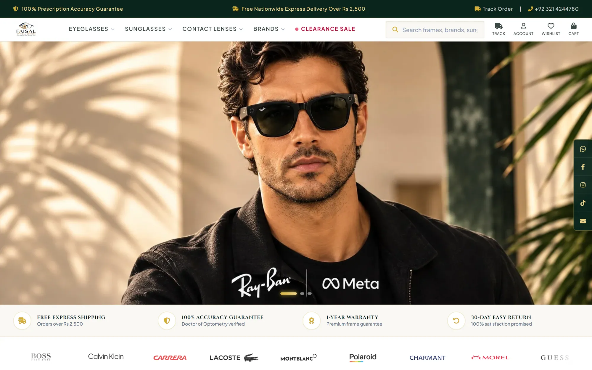
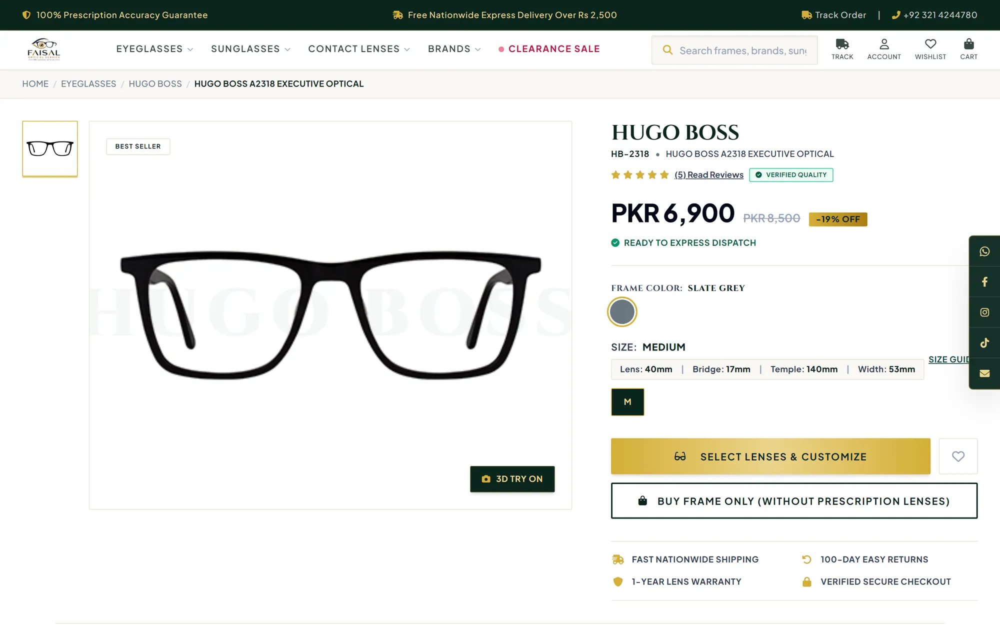
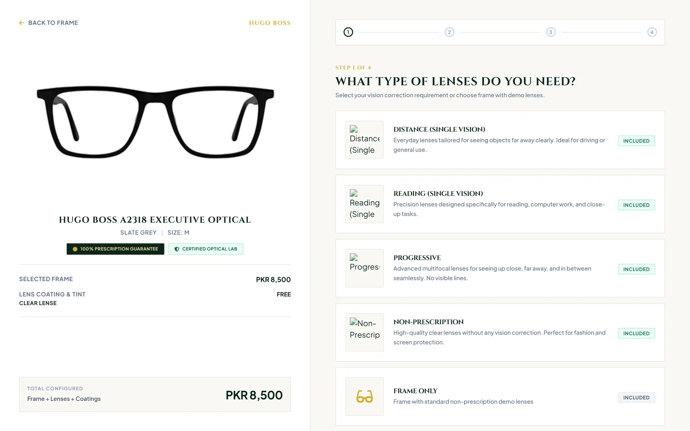
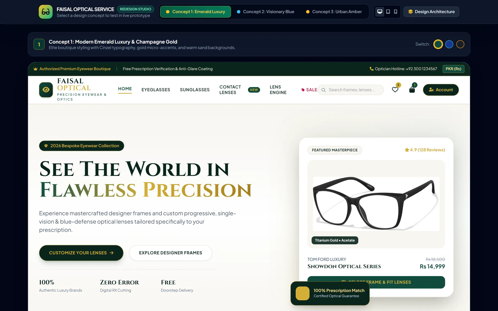
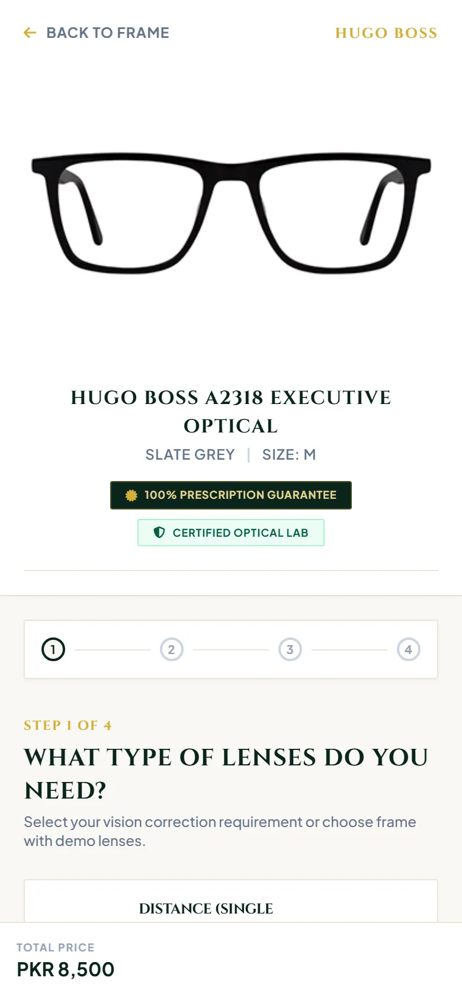
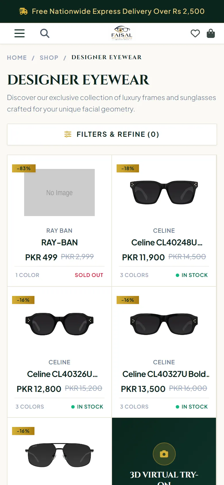
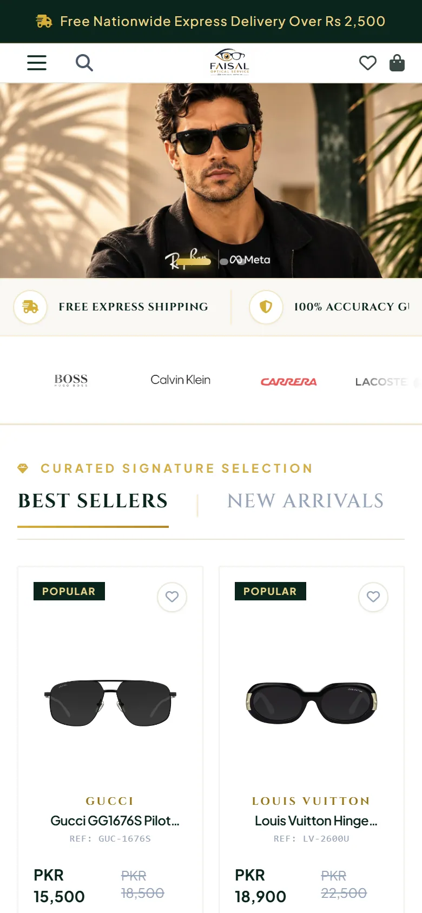

  

# Faisal Optical Service

**An online eyewear store with a step-by-step prescription lens configurator and a full admin back office for the optician.**

> **Portfolio showcase.** The source code is private (client project). This repository presents the project with screenshots and a technical overview. Full case study: **[farhadnazir.com/projects/faisal-optical-service](https://farhadnazir.com/projects/faisal-optical-service/)**

 

| | |
|---|---|
| **Type** | Eyewear e-commerce store |
| **Categories** | Web application, E-commerce, Business system |
| **Platforms** | Web |
| **My role** | Sole full-stack developer |
| **Client** | Faisal Optical Service |
| **Status** | Live |
| **Timeline** | 2026 |

## Overview

Faisal Optical Service is a live online optical store selling designer frames, sunglasses, prescription lenses and contact lenses, priced in Pakistani rupees. Customers browse a filterable catalog, pick a frame color and size, then configure their lenses through a four-step wizard that prices the order as they go.

Behind the storefront is a custom admin panel where the store's staff run the catalog, product variants, orders, stock, coupons, reviews, customers, banners and store settings. The lens options and their prices live in an admin-editable Lens Engine rather than in code.

I was the only developer on the project. I implemented the design, built the Laravel and Livewire application and deployed it to shared hosting.

**Who it is for:** Eyewear shoppers in Pakistan buying frames, sunglasses, prescription lenses and contact lenses online, and the store staff who manage catalog, orders and pricing.

## The problem

Selling prescription eyewear online is harder than ordinary e-commerce. A single order combines a frame variant (color and size), a lens usage type (single vision, progressive, bifocal, non-prescription or frame only), the customer's prescription, a lens package with its own index and thickness, and optional coatings and tints. Each of these affects the price.

The optician's lens price list changes with vision type and prescription strength, and not every lens package suits a strong prescription. Stock also has to stay accurate across frame variants and contact lens SKUs as orders are placed and cancelled.

## The solution

I built the storefront around a dedicated lens configurator that applies the optician's rules in order: frame-only purchases go straight to the cart, non-prescription lenses skip the prescription step, and prescriptions are validated before the customer can continue. High prescriptions automatically limit the choice to lens packages flagged as suitable for them.

Prices come from a package by usage pricing matrix that the store's admins edit themselves, so a new price list does not need a code change. On the operations side, checkout deducts stock at variant or product level, and cancelling an order puts that stock back automatically.

## Key features

- **Four-step lens configurator.** Customers choose a vision need, enter a prescription, add coatings or tints and pick a lens package, with a running total for frame, lenses and coatings. Steps are skipped when the chosen usage does not need them.
- **Prescription entry with validation.** Customers can type a prescription, upload a file, load one saved in their account or send it later. The form checks axis range, requires ADD power for progressive and bifocal lenses, and supports single or dual PD and optional prism.
- **High-prescription lens guard.** The configurator reads the strongest sphere and cylinder values across both eyes. When the prescription is high, only lens packages marked as suitable for it can be selected.
- **Lens Engine and pricing matrix.** Admins manage usages, lens packages, add-on groups, add-ons, tint colors and the prism price. A pricing matrix sets the price of each package per vision type, with auto-fill and per-usage availability.
- **Shareable catalog filters.** Shoppers filter by gender, category, brand, frame shape, style, material, face shape, color, size, price and lens width. Every filter is kept in the URL, so a filtered view can be bookmarked or shared.
- **Contact lens shopper.** A separate contact lens catalog lets customers set power, base curve, diameter and quantity for each eye, with a same-for-both-eyes option and live totals.
- **Checkout, coupons and stock sync.** Checkout supports bank transfer and cash on delivery, validates coupons against minimum cart, discount caps, dates and usage limits, and queues an order confirmation email. Stock is deducted on purchase and restored if an order is cancelled.
- **Admin dashboard and exports.** Admins see revenue and order totals for a chosen period with growth against the previous one, plus low-stock alerts across frames and contact lenses. Customer lists and customer order history can be exported to Excel.
- **Verified-buyer reviews.** Only customers with a shipped or delivered order for a product can review it. Reviews start as pending for moderation, and a scheduled job approves any still pending after 24 hours.
- **Customer account and invoices.** Customers get a dashboard with their order history and saved prescription details, and can download PDF invoices. A wishlist and a public order tracking page sit alongside it.

## Screenshots

<table>
<tr>
<td width="50%" valign="top"> Product pages show frame measurements and lead into the lens configurator or a frame-only purchase.</td>
<td width="50%" valign="top"> Step one of the four-step lens configurator, with the running total beside the frame.</td>
</tr>
<tr>
<td width="50%" valign="top"> An interactive prototype I used to compare three visual directions before the redesign. <i>Design prototype.</i></td>
</tr>
</table>

<table>
<tr>
<td width="33%" valign="top" align="center"> On mobile, the total price stays pinned to the bottom of the screen.</td>
<td width="33%" valign="top" align="center"> Catalog filters open in a drawer and are kept in the URL.</td>
<td width="33%" valign="top" align="center"> </td>
</tr>
</table>

## Architecture

The store is a server-rendered Laravel 12 application. Every interactive page, on both the storefront and the admin side, is a full-page Livewire 3 component with Blade views, Tailwind CSS and Alpine.js, built with Vite.

Data lives in MySQL, with migrations covering catalog lookups, products and variants, contact lens details, the Lens Engine configuration and its pivot tables, orders, reviews, coupons and settings. Authentication uses Laravel Breeze, with an admin middleware guarding the back office and role-based redirects after login.

The application runs on shared hosting, so I made a few deliberate choices to keep it reliable in that environment.

- **Business rules as data.** Lens prices are read from a package by usage matrix, falling back to a base price plus a usage adjustment. I chose this so the optician can update the price list from the admin panel instead of asking for a code change.
- **One component for the configurator.** Step skipping, prescription validation, high-prescription detection and the prism surcharge all live in a single Livewire component, which keeps the ordering rules in one place and easy to check against the optician's workflow.
- **Stock tied to order status.** Stock changes follow order status transitions in both directions: cancelling restores stock and reinstating a cancelled order deducts it again, at variant level for frames and product level for contact lenses.
- **Reusable Excel export.** A single export class takes a model, date column, filters and joins, so new exports in the admin panel do not need their own code.
- **Built for shared hosting.** Migrations check for existing tables before running, file serving has a fallback for hosts that block storage symlinks, and the Lens Engine fails safely if a migration is still pending.
- **Email, invoices and scheduling.** Order and contact emails go through SMTP, with the order confirmation sent from a queue, invoices are rendered to PDF with DomPDF, and the review auto-approval runs as an hourly scheduled command.

## Tech stack

`Laravel` · `PHP` · `Livewire` · `MySQL` · `Tailwind CSS` · `Alpine.js` · `Vite` · `Laravel Breeze` · `DomPDF` · `Laravel Excel`

## Links

- Case study: https://farhadnazir.com/projects/faisal-optical-service/
- Visit live website: https://www.faisalopticalservice.com

## About the developer

Built by **Farhad Nazir**, full-stack software developer in Riyadh, Saudi Arabia, and founder of [Techwine Solutions](https://www.techwinesolutions.com). I build SaaS platforms, business systems, and mobile and desktop apps.

[Portfolio](https://farhadnazir.com) · [LinkedIn](https://www.linkedin.com/in/farhadnazir) · [Email](mailto:farhadnazirksa@gmail.com) · [WhatsApp](https://wa.me/966536566380)

---

Screenshots are shown for portfolio purposes. Rights to each product and its branding belong to their owners. Screens marked "recreated" use demo data, so no real customer data appears.
